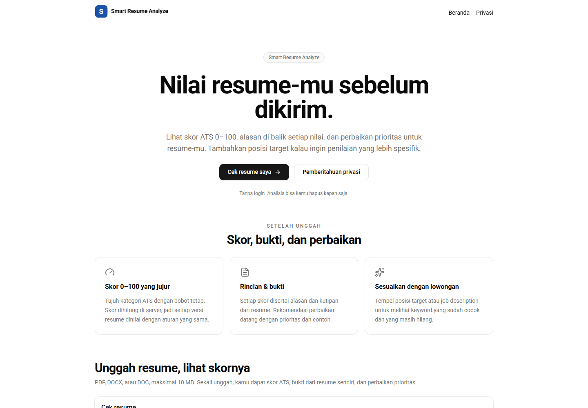
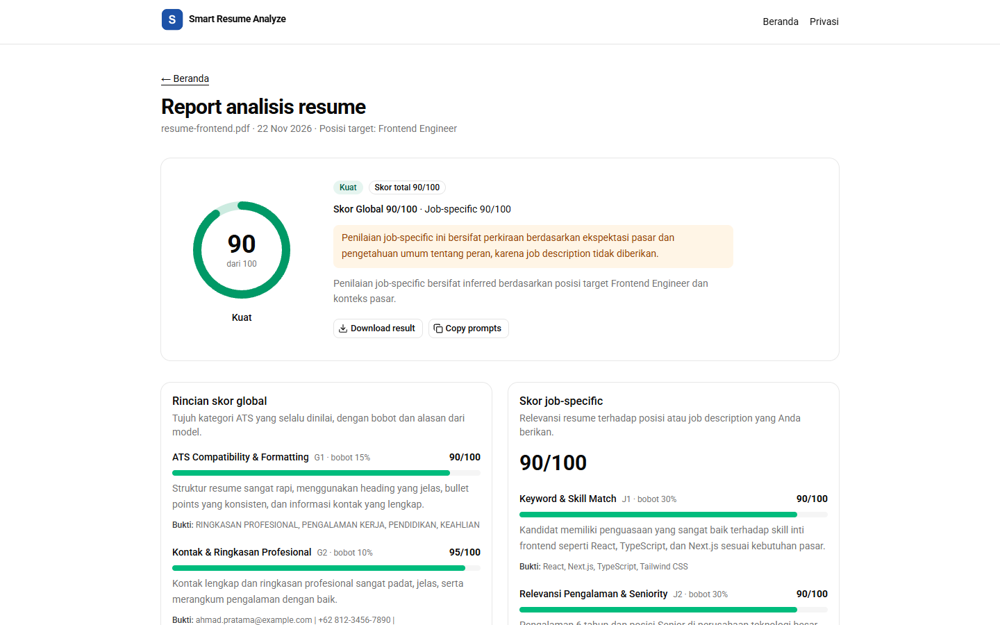
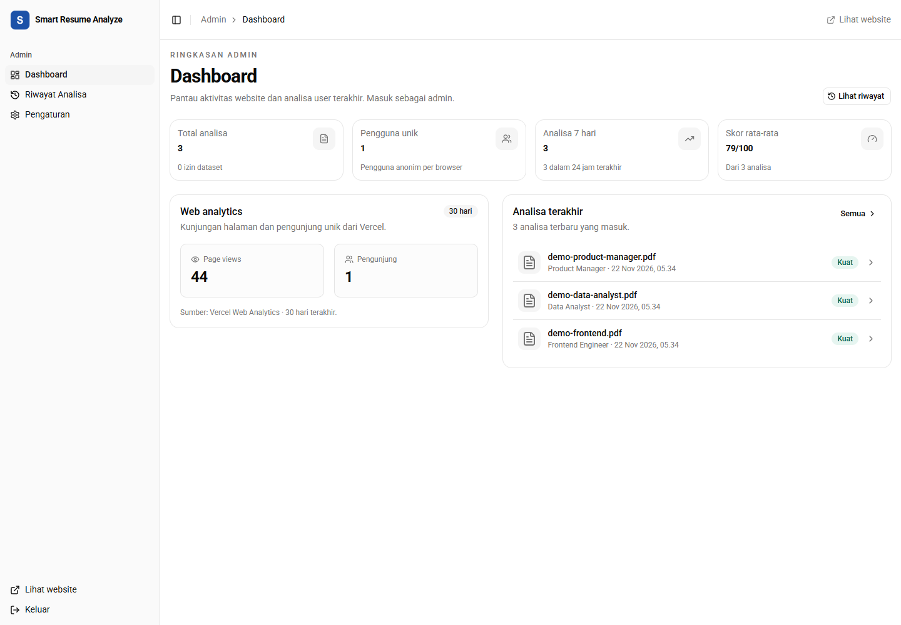
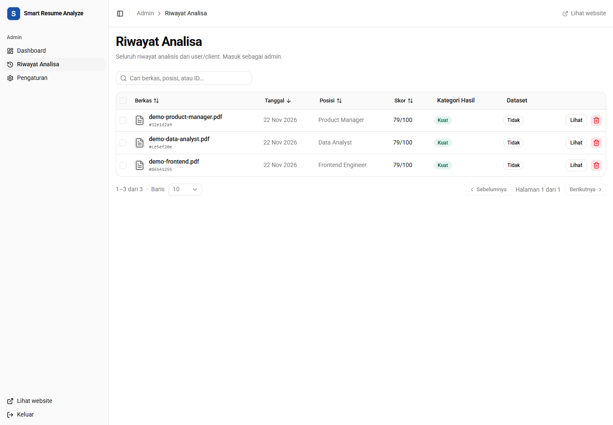
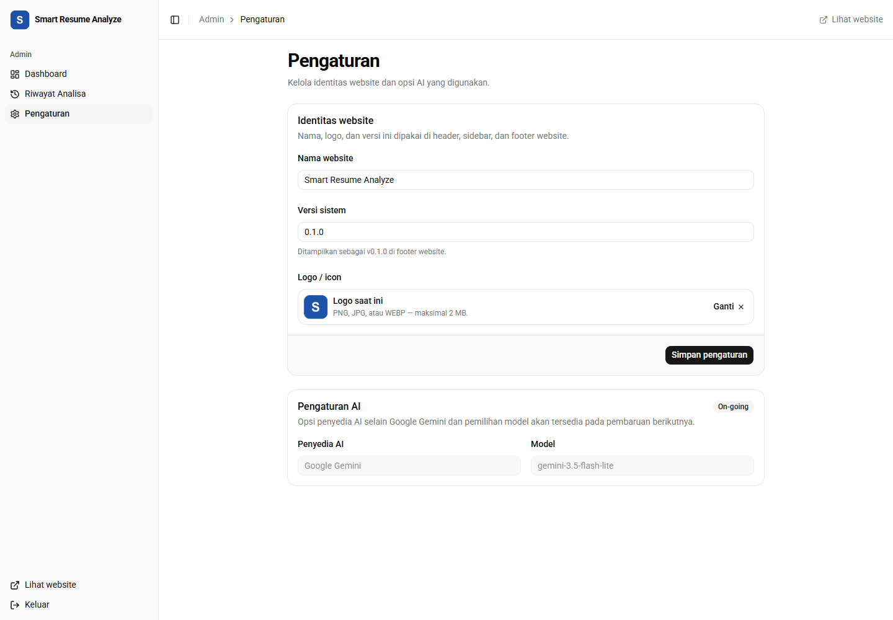

# Smart Resume Analyze

Cek kesiapan resume sebelum dikirim. Smart Resume Analyze memberi skor ATS 0–100, menunjukkan bagian yang sudah kuat, dan menyusun perbaikan berdasarkan prioritas.

**[Buka aplikasi](https://smart-resume-analyze.vercel.app)** · **[Pemberitahuan privasi](https://smart-resume-analyze.vercel.app/privacy)**

*Halaman utama: unggah resume, lihat skor, dan baca perbaikan yang bisa langsung dikerjakan.*

## Yang kamu dapat

- **Skor ATS 0–100** — tujuh kategori penilaian dengan bobot tetap, dihitung dengan aturan yang sama untuk setiap resume.
- **Bukti dari resume sendiri** — setiap skor disertai alasan dan kutipan, bukan sekadar angka.
- **Penilaian sesuai lowongan** — tempel posisi target atau deskripsi lowongan untuk melihat keyword yang sudah cocok dan yang masih hilang.
- **Perbaikan berdasarkan prioritas** — mulai dari bagian yang paling berdampak, lengkap dengan contoh.
- **Laporan yang bisa dibawa** — unduh hasilnya atau salin prompt perbaikan untuk dipakai di aplikasi lain.
- **Tanpa login** — riwayat terikat ke browser, dan analisis bisa dihapus kapan saja.

## Cara pakai

1. **Unggah resume** dalam format PDF, DOCX, atau DOC (maksimal 10 MB).
2. **Tambahkan konteks lowongan** bila ada: posisi target dan deskripsi lowongan bersifat opsional.
3. **Baca hasilnya**: skor total, rincian per kategori, bukti, dan rekomendasi prioritas.
4. **Perbaiki dan ulangi** untuk membandingkan versi resume sebelum dikirim.

## Contoh hasil

*Laporan menampilkan skor total, skor global, skor sesuai lowongan, rincian per kategori, serta bukti dari resume. Data pada screenshot adalah data demo.*

Yang bisa kamu lakukan dari halaman laporan:

- melihat skor dan alasan di balik setiap kategori;
- membaca kutipan resume yang menjadi dasar penilaian;
- mengunduh laporan atau menyalin prompt perbaikan;
- memberi masukan untuk membantu peningkatan kualitas penilaian;
- menghapus analisis beserta berkas aslinya.

## Area admin

Pengelola website bisa masuk ke area admin untuk memantau aktivitas dan mengelola konten.

*Dashboard: total analisa, pengguna unik, skor rata-rata, statistik kunjungan, dan analisa terakhir.*

### Riwayat Analisa

*Cari, urutkan, pilih beberapa baris, hapus massal, dan atur jumlah baris per halaman.*

### Pengaturan

*Ubah nama website, logo, dan versi sistem yang tampil di footer.*

*Seluruh screenshot di README ini menggunakan data demo.*

## Privasi

- Resume hanya diproses setelah kamu memberi persetujuan.
- Berkas asli disimpan di penyimpanan privat dan dihapus saat analisis dihapus.
- Izin pemakaian data untuk peningkatan kualitas atau pelatihan model bersifat opsional dan tidak dicentang secara default.
- Riwayat terikat ke browser, bukan akun. Menghapus data situs di browser akan memutus akses ke riwayat lama.

Baca rinciannya di [Pemberitahuan privasi](https://smart-resume-analyze.vercel.app/privacy).

## FAQ

**Format file apa yang didukung?**  
PDF, DOCX, dan DOC, maksimal 10 MB.

**Apakah perlu membuat akun?**  
Tidak. Kamu bisa langsung unggah resume. Riwayat analisis disimpan untuk browser yang sama.

**Apakah skor ini jaminan lolos seleksi?**  
Tidak. Skor dan rekomendasi adalah alat bantu untuk memperbaiki resume, bukan jaminan lolos ATS atau seleksi perekrut.

**Apakah resume saya dipakai untuk pelatihan model?**  
Hanya jika kamu mencentang izin dataset. Tanpa izin tersebut, analisis tetap tersimpan sebagai laporan pribadi dan tidak dipakai untuk pelatihan model.

**Bisakah analisis dihapus?**  
Bisa, dari halaman laporan. Menghapus analisis juga menghapus rekomendasi, masukan, dan berkas asli.

## Dokumentasi teknis

Untuk setup lokal, environment, testing, deployment, dan detail arsitektur, lihat [README_FOR_AGENTS.md](README_FOR_AGENTS.md).
